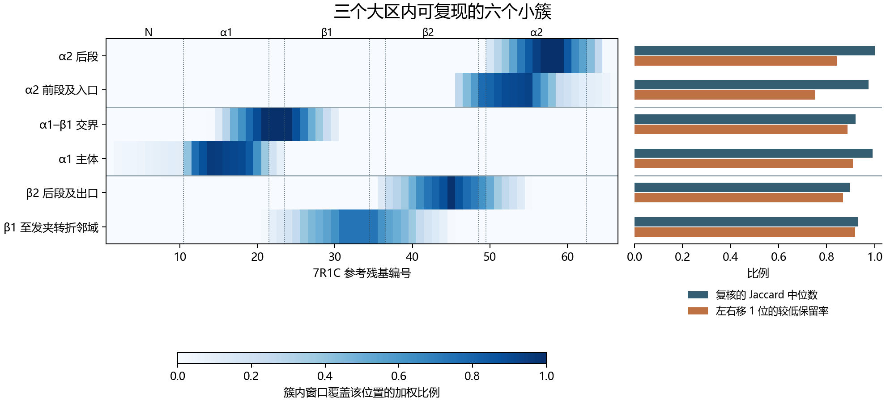

# GvpA 谱聚类的区域细分与功能解释

建议用三个结构大区和六个局部小簇展示 M3。α1 候选在同源组内的位点差异较小，成员对切窗起点敏感。现有证据支持给区域补充候选作用，尚不足以新增功能类别。

## 如何分区和预测

输入为 1,202 条发现序列的 12,175 个 10 aa 核心窗口。ESM 窗口均值减去各自蛋白实际 HMM 匹配残基的均值，得到 480 维表示。先在全部窗口拟合 PCA20、构建含自身的 15 近邻图，对邻接矩阵取对称平均，再用归一化图拉普拉斯的低特征向量和 QR 标签分配进行谱聚类。ARPACK 的随机种子为 42。多 K 探索在每张图上复用谱分解的前 K 个向量。正式候选复核调用 sklearn 公共 SpectralClustering 接口，并按原发现窗口的身份摘要核对分区。

同一个大区内再次聚类时，只取该区窗口，从 480 维表示重新拟合局部 PCA 和近邻图。新窗口依次使用每一级冻结的 PCA，由该级 15 个训练近邻按距离倒数投票，沿选中的分支向下走。结构位置和已知作用只用于事后解释；结构映射参与了上游窗口筛选。[模型实现](../../models/spectral_regions.py) · [冻结标签迁移与候选复核](../../scripts/m3_spectral_alpha1.py)

## 主分组如何确定

在同一发现集上比较 26 种 K（2–20 的全部整数及 24、32、48、64、80、100、120）。每次抽 220/275 个同源组重拟合，比较 8 次抽样两两重叠窗口的分区。同时在固定的 2,000 个窗口上算轮廓系数。K＝3 两项均居首，ARI 中位数 0.967，轮廓系数 0.280；K＝12 分别为 0.702 和 0.160，K＝80 为 0.876 和 0.242。此前 K＝12 的固定粒度实验可用于展示同一区域内部的差异。[全 K 指标](spectral_hierarchy_runs/global/all_k.csv) · [分组抽样比较](spectral_hierarchy_runs/global/pairwise_stability.csv) · [原 K＝12 报告](spectral_k12.md)

在三个大区内分别比较 20 个拆分方案（2–16、20、24、32、48、64），并允许保留整个大区。12 次抽样初选出 2、2、3。6 次额外抽样显示 β 发夹三分的两个小簇恢复不足；另用 8 个新种子比较二分与三分，二分两簇的成员 Jaccard 中位数为 0.895 和 0.930。最终三大区各分成两个子簇，分支检验在发现集完成。[筛选规则](spectral_hierarchy_runs/regions/protocol.json) · [局部扫描](spectral_hierarchy_runs/regions/k_scan.csv) · [β 发夹追加八次比较](spectral_hierarchy_runs/regions/beta_additional_refits.csv)

| 大区 | 小簇与参考结构位置 | 验证窗口 | 区域证据支持的解释 |
|---|---|---:|---|
| α2 | 后段，53–62 | 632 | 可定位到 α2 后段，两个队列均无 ≤100 aa 蛋白进入此簇。 |
| α2 | 前段及入口，48–57 | 654 | 螺旋折回覆盖发夹，在含 GvpC 的体系有外侧支撑界面证据，具体前后段分工待验证。 |
| α1 及邻近区 | α1–β1 交界，18–27 | 839 | 从跨肋螺旋进入 β 链支架的过渡区域。 |
| α1 及邻近区 | α1 主体，12–20 | 772 | 参考结构支持跨肋连接；含 α1 的 N 端片段在特定古菌体系中还显示出与 GvpF 的互作。 |
| β 发夹 | β2 后段及出口，41–50 | 1,012 | 肋支架以及特定装配位置的 β 链接触。 |
| β 发夹 | β1 至转折邻域，29–38 | 1,367 | 肋核心及疏水内壁；转折邻域另有实验支持其与气囊形态有关。 |

参考位置为 7R1C 编号，取至少半数加权窗口共同覆盖的位置。此前已使用的 519 条保留序列贡献 5,276 个合格窗口，六簇的参考位置分布重叠为 93.5%–99.3%。该指标衡量位置分布的可重复性。当前项目没有逐窗口的真实功能标签。[逐簇统计](spectral_hierarchy_runs/regions/final_six.csv) · [气囊原子结构](https://pmc.ncbi.nlm.nih.gov/articles/PMC9994262/) · [GvpC 外侧支撑](https://pubmed.ncbi.nlm.nih.gov/37040766/) · [转折区表型](https://pubmed.ncbi.nlm.nih.gov/28898511/)



## 六个小簇内还能否多解释一种功能

固定六个上层归属，在每个小簇内部各测 20 种拆分、12 次同源组重抽样。1,938 个跨分辨率的候选子簇里，826 个通过成员稳定性筛查；各 K 的候选会重叠。在已知结构接触涉及的 10 个位置上，按完全相同的参考位置组合与长度档匹配，598 项比较满足支持度要求，4 项差异超过 20 个百分点。两个 β 区候选的 38 位酸性差异在验证组归零；α1 内 6 位候选方向反转；7 位候选在匹配同源组后可比样本大幅减少。十个位点以 N 端和 β 区为主，缺少能区分 α2 子群 GvpC 结合的直接测量。[候选筛查](spectral_hierarchy_runs/function/protocol.json) · [四项迁移复核](spectral_hierarchy_runs/function/replication.csv)

### α1 候选的进一步复核

K＝24 在本节指六个小簇中的 α1 主体内部曾出现候选的探索分辨率。它对应一部分延伸至 N 端的窗口。比较候选与同父簇其余窗口在参考第 7 位出现丝/苏氨酸的比例。表中为候选减去对照的加权百分点数，逐次剔除一组的范围用于描述对单个同源组的敏感性。

| 队列 | 匹配位置、长度后 | 再匹配同源组 | 组内可比组数 | 组内逐一剔除一组后的范围 |
|---|---:|---:|---:|---:|
| 发现集 | +37.3 | +4.8 | 6 | −2.6 至 +9.5 |
| 验证集 | +43.7 | −6.0 | 3 | −9.1 至 0.0 |

再用原始残基嵌入重算平移后的窗口特征，依次通过三级冻结模型。在验证集的 47 个候选窗口中，向左移 1 位后 46 个保留，向右移 1 位后 36 个保留，向右移 2 位后只保留 3 个，按同源组、序列和窗口均衡的保留率为 2.1%。这三个偏移下全部 47 窗均满足参考覆盖要求。发现集向右移 2 位后保留 39/100 个。两队列所有原位候选特征与归档逐元素相等。[位点与剔组结果](spectral_hierarchy_runs/alpha1/chemistry.csv) · [各方向平移结果](spectral_hierarchy_runs/alpha1/window_shift.csv)

α1 区可列出装配阶段的伙伴蛋白接触这一候选解释。已有实验定位到含 α1 的片段，并显示互作受装配蛋白背景影响，尚未把这一作用特异地归给上述 7 位候选。[GvpF 片段实验](https://pmc.ncbi.nlm.nih.gov/articles/PMC7688916/) · [互作体系背景实验](https://pmc.ncbi.nlm.nih.gov/articles/PMC11445434/)

## 复现本次 α1 复核

使用 requirements-m3-spectral.txt 的环境。下列参数分别指向原始运行的本地结果，两个 embedding 目录需包含原清单和 cache。配置绑定输入文件哈希和每一级发现集窗口集合的摘要。脚本从发现集重建三个已选节点，然后在验证集做冻结迁移。输出目录须为新目录。

```text
python scripts/m3_spectral_alpha1.py --discovery core_anchor_mean_probe_run --discovery-mapping alignment_audit/residue_reference_mapping.csv --discovery-embeddings M3_FULL_DISCOVERY_20261022_001/embeddings --validation M3_SPECTRAL_VALIDATION_20261023_001/prepared --validation-mapping M3_SPECTRAL_VALIDATION_20261023_001/prepared/accepted_reference_mapping.csv --validation-embeddings M3_SPECTRAL_VALIDATION_20261023_001/embeddings --output M3_ALPHA1_CHECK
```

本次复核对应提交 `18eaa6a4e48b23460df80e7541f1894bab530e90`，两次生成的两份结果表字节一致。之前的选 K 与多级探索随 PR 归档参数、图和汇总数据；上述命令重建并检验选定的 α1 分支。完整上游特征、逐残基嵌入和历史探索运行包保存在项目本地，普通 Git 提供小型汇总。正式测试 154 项通过，78 项子测试通过，1 项既有 PyHMMER 重扫因缺包跳过。M2 发布校验通过。[输入锁定配置](../../configs/m3_spectral_alpha1.json) · [环境与结果摘要哈希](spectral_hierarchy_runs/receipt.json)
