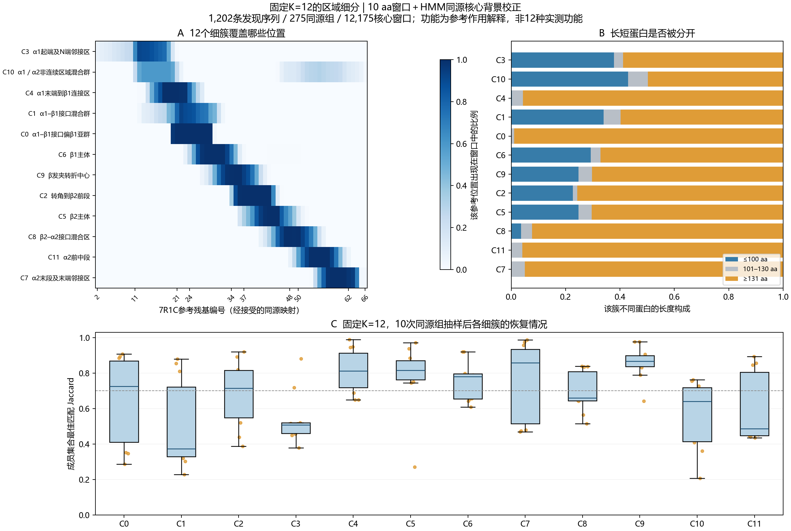

# 谱聚类 K＝12：代码边界、结果和新窗口分配

关联 [Issue #27](https://github.com/Lithium9767/MLP/issues/27)。本分支从 main 创建，与原 HDBSCAN 实现 [PR #22](https://github.com/Lithium9767/MLP/pull/22) 分开审查，不覆盖其历史结果。

## 这轮解决什么

原 30 aa 全窗口主配置得到 4 簇、约 30.68% 噪声，并出现大簇和长度混杂。用户希望细分区域，因此本轮固定谱聚类 K＝12。谱方法根据近邻连接划分图，值得用于比较非球形的分布；但 HDBSCAN 也能处理非凸簇，二维图形不规则不能单独证明密度方法不适用。K＝12 是探索粒度，不是天然功能数。

当前输入已不同于原 4 簇实验：10 aa、步长 5，只保留至少 8 个 accepted 7R1C 同源映射残基的核心窗口；每个窗口的 ESM 均值减去其蛋白实际 PF00741.24 match states 1–39 残基的均值。原 30 aa 结果不能直接用于证明本轮谱方法优于其他算法，需要同一窗口、同一特征、同一评估的对照。

这是一项有同源与结构先验的区域探索。结构区域名称不进入 PCA 或谱图，但结构映射参与窗口筛选，HMM 参与背景定义。不能用同一结构映射的吻合程度冒充独立功能准确率。

## 代码审查与实际整理

审查发现探索脚本 `core_anchor_mean_probe.py` 在导入时创建目录、读取本机绝对路径并运行实验，`fit` 依赖全局输出路径/K 列表，还调用 sklearn 私有 `cluster_qr`。这些脚本只作为旧实验来源保留在 Git 外，不复制进正式模块。

原 PR #22 的 `m3_discovery.py` 还有应单独修复的来源检查问题：分析入口筛选清单后只比较清单长度，可能允许嵌入子集；`cohort` 的缓存身份验证不足，且主配置键和 30/5 窗口参数重复硬编码。本 PR 不宣称已修复这些未使用的旧入口。新入口通过固定来源哈希、逐行窗口键、完整窗口/序列/同源组数量以及特征语义版本检查，避免继承这些路径。

本轮新增两个有明确职责的代码文件：

- `models/spectral_regions.py`：只做数组计算、冻结模型和安全 NPZ 保存/读取，不读取 CSV，不知道蛋白功能名称或本机数据路径。
- `scripts/m3_spectral.py`：检查特征包与窗口表、编排 fit/predict/evaluate、输出表和运行收据，不重复实现谱聚类或投票规则。

配置只维护一份模型参数；`configs/m3_spectral_source.json` 单独锁定现有特征产物。预测与拟合使用同一模型模块，测试覆盖来源、行顺序、同源隔离、冻结推断、零距离和平票行为。没有新增并行的“最终版”脚本或整套旧流程。

## 输入与调用关系

```text
已核验的上游特征包 + 窗口表 + 来源清单 + 配置
  → load_bundle（哈希 / 行键 / 特征版本 / split / 队列检查）
  → fit_spectral（PCA → 对称近邻图 → 谱聚类）
  → model.npz + assignments.csv + 收据

相同语义的新窗口特征包
  → load_bundle → load_model → model.predict
  → predictions.csv（候选簇、投票、距离）
```

特征 NPZ 必须有 `features`（N×480 浮点数组）、`internal_id`、`raw_start`、`raw_end`。后三项必须是一维、等长且与窗口 CSV 顺序完全一致；位置数组必须是整型。上游包含的其他数组不参与模型。CSV 的 `structure_audit_class`、区域名、片段等注释不作为特征。

当前受核验上游是 `core_anchor_mean_probe_run/features.npz` 和 `core_windows.csv`：12,175 窗口、1,202 discovery primary 序列、275 同源组。原 29,389 个 10 aa 窗口中的另 17,214 个不满足当前核心筛选，不因本次 K12 自动获得解释。上游是历史探索产物，其原脚本/收据身份保留；新代码的干净运行不能倒改上游探索历史。

本入口消费已有表示，**不提供任意 FASTA 到结果的端到端命令**。新蛋白须先由上游以固定 ESM revision 生成全蛋白上下文残基表示、核验序列身份和 HMM 背景，并产生同样的窗口与 accepted 映射；改变构造方法就必须更换 feature_schema。来源清单是生产者的来源声明，哈希只证明字节身份，本身不能证明生物学正确性。

## K12 怎么拟合

1. 用 discovery 特征拟合 full-SVD PCA 20。
2. 在 PCA 空间建立 15 近邻 connectivity 图，包含自身（即通常 14 个其他邻居），再取 `(A+A.T)/2`。单向边为 0.5、双向边为 1。
3. 调用公共 `SpectralClustering`，固定 `n_clusters=n_components=12`、`assign_labels=cluster_qr`、ARPACK、seed 42；不再直接依赖私有 sklearn 模块。
4. 保存 PCA 均值/投影、训练点坐标、0–11 簇标签、参数、特征语义及诊断。NPZ 不使用 pickle；内容摘要用于检查意外损坏，不是来源的数字签名。

## “预测”究竟怎么预测

sklearn 的谱聚类只有训练图上的标签，没有原生 `predict`。这里明确增加一个后处理器：[官方谱聚类接口](https://scikit-learn.org/1.8/modules/generated/sklearn.cluster.SpectralClustering.html)。

例如一个已通过上游筛选的新 10 aa 窗口，先计算 `x = 窗口残基表示均值 - 该蛋白HMM核心残基表示均值`，得到 480 维输入，再用保存的 PCA 做 `(x - mean) @ components.T`。模型只减 PCA 的训练均值，不会再次减蛋白背景。

在这 20 维坐标中找 15 个训练近邻，按距离的倒数投票。假如 C6 获得总票权的 0.8，候选簇就是 C6。零距离时只让零距离邻居投票；平票选择较小的簇编号并输出零票差。新点不会改变 PCA、图或已有标签。这是近邻标签迁移，不是把新点加入图后重跑谱聚类；可参照 [距离加权近邻分类](https://scikit-learn.org/1.8/modules/generated/sklearn.neighbors.KNeighborsClassifier.html)。

结果包含 `candidate_cluster`、`vote_fraction`、`vote_margin`、`nearest_distance`。0.8 表示近邻票权的一致程度，**不表示功能正确概率 80%**。本轮没有校准陌生分布的拒绝阈值，因此远离训练分布的点也只返回候选；不能据此发布可靠的全自动功能判定。未通过核心筛选的窗口不应送入该模型。

## 检验预测，不伪造准确率

`evaluate` 按同源组留出 20% discovery，seed 42/43/44。每次仅在剩余组重新拟合 PCA、近邻图和 K12，再给留出窗口迁移标签。簇编号本身无固定含义，因此仅用训练共同窗口做 Hungarian 对齐，然后检查留出预测。

对照是全 discovery 的参考分区，它见过留出组。所以输出的是“与全发现集参考分区的一致性”，**不是独立泛化准确率，更不是生物功能准确率**。既报告窗口一致比例，也报告每个留出同源组等权的一致比例和 ARI。519 条 validation 全程未使用，旧冻结验证入口保持原样。

## 运行命令

先安装 `requirements-m3-spectral.txt`，并在干净、已提交的工作区运行。将审核过的上游包放在任意外部目录，不改源码中的路径。以下 PowerShell 使用相对路径示例，`inputs/core` 代表实际外部目录。

```powershell
python scripts/m3_spectral.py fit --features inputs/core/features.npz --windows inputs/core/core_windows.csv --source configs/m3_spectral_source.json --output outputs/spectral_k12/fit
python scripts/m3_spectral.py evaluate --features inputs/core/features.npz --windows inputs/core/core_windows.csv --source configs/m3_spectral_source.json --model outputs/spectral_k12/fit/model.npz --output outputs/spectral_k12/evaluation
python scripts/m3_spectral.py predict --features inputs/new/features.npz --windows inputs/new/windows.csv --source inputs/new/source.json --model outputs/spectral_k12/fit/model.npz --output outputs/spectral_k12/new_predictions
python -m pytest -q tests/test_spectral_regions.py tests/test_m3_spectral.py
```

新包的 source.json 使用相同 feature_schema 和新文件的实际 SHA-256。预测仅接受 `discovery`（内部诊断）或 `new` split；标为 validation 的数据会被拒绝。哈希或行顺序不匹配直接失败，输出目录不能覆盖；模型运行失败保留失败收据。

## 解释结果的边界

已有 K12 十次完整同源组抽样重拟合 ARI 为约 0.497–0.771，中位约 0.700。C9 的发夹转折中心相对稳定；C6 对应 β1 主体、C5 对应 β2 主体。C1/C3/C10/C11 等边界不稳定，C10 混合非连续 α1/α2 区域。12 类不是 12 个互斥功能，同一蛋白通常参与多个窗口簇。

区域可与结构/突变文献提出功能假说，但本项目序列没有实测功能标签；例如 β 发夹相关结构支架/内壁、α1 相关跨肋连接，只能按同源区域解释，不能给每个簇强行命名一种新功能。详细旧探索证据见 [逐簇说明](spectral_k12_evidence/cluster_regions.csv) 和 [十次重拟合](spectral_k12_evidence/refit_stability.csv)，不能由邻居投票自动生成。它们从 `M3_K12_REFINEMENT_20261023_001` 原样复制，保持探索性证据身份，未冒充本次新运行。



此图是位置组成与稳定性，展示没有单一功能解释的混合簇；不是二维投影中的功能分类准确率。

本次干净运行数字与源码提交见同目录 `spectral_k12_runs/` 的运行收据及摘要。自动化技术检查不代替成员审核、负责人冻结或独立生物实验。
