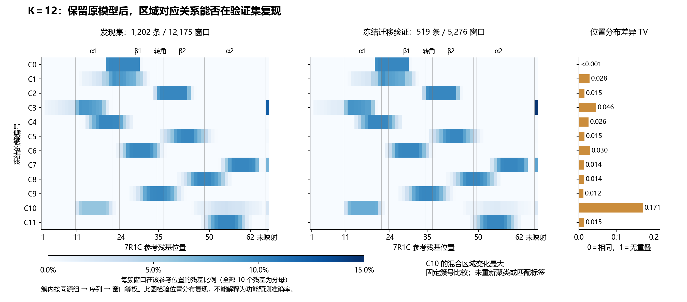

# 519 条保留验证序列：冻结 K12 的真实迁移结果

按用户在查看 PR #28 后提出的“用一下啊？”执行。本次先把已有表示、模型、PCA、全部 12 个簇与评价口径写入 [冻结协议](../../configs/m3_spectral_validation_freeze.json)，提交为 `f1a5892e8993ca55aecb94f74abc035bcf7c132d`，随后才提取验证表示和评估。原始 HDBSCAN 的冻结入口保持原样，本次授权只覆盖谱聚类 K12。

**主要区域对应关系在验证序列中复现，C10 仍然混杂。** 固定模型没有重训，未用验证结果选择 K、修改参数或重新匹配簇编号。所有“预测”均指原 K12 的候选窗口标签；本项目没有真实功能标签。

## 实际用了哪些数据

| 项目 | 数量 |
| --- | ---: |
| primary 验证序列 | 519 |
| 验证同源组 | 118 |
| 与发现集的 ID / 序列 SHA / 同源组交集 | 均为 0 |
| 10 aa、步长5的全部验证窗口 | 12,902 |
| 至少8个 accepted 同源参考残基的合格核心窗口 | 5,276 |
| 不送入当前模型的其余窗口 | 7,626 |
| 至少有一个合格窗口的验证序列 | 519 / 519 |

模型给合格窗口输出候选簇。其余窗口没有自动获得功能解释；“519条全部覆盖”也不代表功能预测100%正确。

仍使用固定 ESM-2 t12 35M revision、全蛋白上下文、最后一层残基表示。窗口特征为其10个残基的均值减去该蛋白实际 HMM match states 1–39 残基的均值。ESM 权重不训练，只使用 `last_hidden_state`，不使用 pooler 或语言模型任务头。与发现集的实际提取运行保持同一 NumPy/torch/transformers/safetensors 版本，首次批次重复推理最大差为0。

HMM 与 7R1C 规则沿用发现集，不填补缺失 HMM 状态、不接受 tentative 映射。GVPA_002078 长59 aa，仅有36个状态（缺1–3），符合既定最少20个状态规则，因此照常处理，没有为它调整规则。α2 延伸通过既定描述阈值的序列为516/519，N端为112/519；这些是同源映射支持，不能解释为映射准确率。

## 对应区域是否保持

下表的组成比例均在各簇内部按“同源组→序列→窗口”等权统计，分母为每窗口全部10个原始残基，含未映射部分。TV比较完整参考位置分布，0表示相同、1表示没有重叠；它不是样本错误率。

| 原簇 | 验证窗口 / 序列 / 组 | 验证集主要区域组成或描述 | 与发现集位置分布 TV |
| --- | --- | --- | ---: |
| C0 | 97 / 97 / 30 | α1–β1接口偏β1的亚群 | 0.0003 |
| C1 | 589 / 413 / 104 | α1–β1混合；未因此变成单一功能 | 0.0282 |
| C2 | 183 / 183 / 59 | 转角到β2前段；β2约76.2% | 0.0149 |
| C3 | 455 / 248 / 61 | α1起端及N邻接区 | 0.0463 |
| C4 | 381 / 380 / 95 | α1末端到β1连接区 | 0.0255 |
| **C5** | **710 / 519 / 118** | **β2主体，β2残基约93.2%** | **0.0148** |
| **C6** | **456 / 456 / 105** | **β1主体，β1残基约93.8%** | **0.0295** |
| C7 | 305 / 305 / 85 | α2末段 | 0.0136 |
| C8 | 486 / 396 / 104 | β2–α2过渡混合区 | 0.0143 |
| **C9** | **621 / 519 / 118** | **β发夹转折邻域，转角残基约20.0%** | **0.0121** |
| **C10** | **554 / 317 / 76** | **非连续α1/α2混合，变化最大** | **0.1712** |
| C11 | 439 / 389 / 99 | α2前中段 | 0.0145 |

12个冻结簇在验证数据中均收到候选窗口分配；这不等于在验证集重新发现了12个天然簇。完整数值见 [逐簇表](spectral_validation_runs/cluster_transfer_summary.csv)。

12簇平均参考位置分布重叠为96.79%（平均TV为0.0321）。这是**条件区域谱重叠**，不能写成分类准确率或功能准确率。结构映射参与了窗口筛选，结果支持的是在同一结构先验下区域解释可以跨保留同源组迁移。

预注册对照在每条验证序列内部置换标签100次，保留每条序列的簇计数、组归属和簇参与关系，破坏窗口与位置的对应。对照的平均重叠约27.96%，100次均低于观察值，plus-one p=1/101≈0.0099。它检验条件位置关联，不证明分子功能、作用因果或12种功能的存在。

## 分布偏移与可靠性诊断

- 训练跨同源组最近距离的固定95%分位阈值为0.45048；验证窗口中3.54%超过它，按组/序列/窗口等权为3.82%。
- 训练 PCA 残差能量比例的固定95%分位阈值为0.29129；验证窗口中6.88%超过它，等权为7.82%。验证残差中位数0.1252，发现集为0.1180。
- 邻居票权占比中位数为1，最低约0.4206。票权只反映邻居一致程度，未校准成功能正确概率。

上述阈值都只由发现集确定，是诊断标记，不自动拒绝、改簇或修改模型。该结果没有显示大范围 PCA 空间距离偏离，但保留了部分残差偏高的窗口及 C10 的区域组成变化。

## 能得到什么结论

C5、C6、C9 等簇的局部区域解释在519条未参与拟合的保留序列上复现，因此其可迁移性获得了新的证据。C10 的混合没有被验证消除，原发现集组抽样中 C1/C3/C10/C11 的边界不稳也仍然保留。本轮不因验证结果再次细分或重新选择 K。

β1/β2及转角属于相邻结构部分，可共同参与支架、装配和内壁作用，不能把它们按簇数强行解释为互斥功能。真正的功能判定仍需要独立突变/生物学证据。

这519条来自既有数据库划分，按当前同源阈值隔离，并非一个新实验体系的外部队列。验证集现已用于本次评估；后续若依据这些结果修改模型，应明确记作再探索，不能继续称这批数据从未使用。

## 复现与审查

入口 `scripts/m3_spectral_validate.py` 分三步运行，参数及实际外部目录见三个收据中的完整命令。先用与原表示提取相同的环境运行 `embed`、`prepare`，再用 `requirements-m3-spectral.txt` 对应的环境运行 `transfer`。新输入环境版本见 `requirements-m3-validation-inputs.txt`。三个步骤都先检查冻结协议、模型/配置/输入/实现哈希及干净提交，不通过普通predict入口把validation改名为new。

1. `embed`：519条验证序列，保存残基表示及哈希。
2. `prepare`：原HMM锚点和同样的延伸规则，构建相同含义的特征，单列未选窗口。
3. `transfer`：冻结PCA及15近邻距离加权投票，使用原0–11编号，计算预先固定的比较指标。

验证前还先在1202条发现序列上检查新构建模块：66,351对 accepted 坐标完全一致，全部窗口顺序和12,175×480特征逐元素一致。源码提交完整测试为152 passed、1 skipped、78 subtests passed；跳过项仍是既有PyHMMER重扫环境限制。M2 validator及差异检查通过。

记录：[嵌入收据](spectral_validation_runs/embedding_receipt.json)、[准备收据](spectral_validation_runs/preparation_receipt.json)、[冻结迁移收据](spectral_validation_runs/transfer_receipt.json)、[原始统计摘要](spectral_validation_runs/validation_summary.json)、[助手独立核验](spectral_validation_runs/assistant_verification.json)。冻结模型SHA-256运行前后均为 `731cfbd4cf68b15526e4b54af7b14ac4602d9e708162a2892de78d986b3ee44f`。

完整5,276行预测、逐窗诊断、未选窗口、坐标与数组存于外部产物目录 `M3_SPECTRAL_VALIDATION_20261023_001`；普通Git只保存小型汇总、图和收据。助手独立技术检查不代替真实团队成员Review、M3验收或功能实验。
